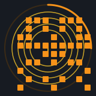

<p align="center">
  
</p>

# SEAL

SEAL is one inscription per Bitcoin block height. Only the first inscription of an exact text is valid. The rule is first is first. A later copy of the same text is not a seal. The inscription is text. The picture is computed from the block named by that first text.

The seal of block 0 is the first inscription whose text is exactly:

```
0.seal
```

A later inscription of the same text is not a seal.

## The text

The body matches:

```
^(0|[1-9][0-9]*)\.seal\n?$
```

The number is a block height that already exists when the inscription is confirmed. The full rule for indexers is in [specification.md](specification.md).

## The picture

The picture is not stored in the inscription. It is drawn from the block named by the text.

- The squares are the last 16 hexadecimal characters of the block hash. They fill the left five columns of a 9×9 grid, 45 bits. The right half is the mirror and adds none. There are 2^45 figures, 35184372088832. Each figure is one of them. That count is the same for every figure.
- The orange arc is the minute of the block timestamp, starting from the top of the hour.
- The vertical line is the transaction count, from 1 to 7000.
- The circles follow the first five subsidy eras, the early halvings. Block 0 has five. Each of those halvings removes one. From height 840000 on, only one circle remains.

The exact measures and colors are in [specification.md](specification.md). The same drawing is in [js/glyph.js](js/glyph.js).

## Use

Someone inscribes the text of a block height that already exists. The first confirmed inscription of that exact text is the seal of that height. A later copy of the same text is not a seal.

The inscription stays text. A wallet or an explorer that follows the rule keeps the earliest inscription and draws the picture from the block named by the text. The same arrangement is used by Bitmap: the file is text, and the picture is computed.

A seal is a collectible. The first inscription has one holder.

The same height can name a Bitmap district. `{height}.bitmap` is the ground of that block. `{height}.seal` is its crest. An application that reads both may show the seal on that district when one wallet holds the two first inscriptions. Building stays with Bitmap. Neither protocol requires the pair.

## Confirmed

Eleven seals were confirmed in block 971633. Each body is `text/plain;charset=utf-8` and matches the rule exactly. The same ids are in [seals.json](seals.json).

- [`0.seal`](https://ordinals.com/inscription/d4f7d96eb1d3ecc621c1d000f0be451d220bdee29921f6d799adb61b86c8e369i0)
- [`1.seal`](https://ordinals.com/inscription/e1e695959e59ab000eb6af55e20c919eb311add6c6b766382faf1e15e5a98911i0)
- [`2.seal`](https://ordinals.com/inscription/daba26fd880c532ad8a75e7a0b310e27d4d13c0ec38d60099dfedec3e061113di0)
- [`3.seal`](https://ordinals.com/inscription/50b1a22bde8822d85579acd6bda227767f5a364244f454f6df382a7cd0bf4e11i0)
- [`4.seal`](https://ordinals.com/inscription/49a5b66a8b651b926d77dc96e1aeff3dd0ee2be23bbb784cf4918fa4d22c6790i0)
- [`5.seal`](https://ordinals.com/inscription/5bbca5d75f8babfed9804778d666e498351d39fa20c75f5abef75a240ae6e83bi0)
- [`6.seal`](https://ordinals.com/inscription/8e748fb44771b5c4334968e09f773c4e4fa5c078b9fd45f0231ec21e5f535de9i0)
- [`210000.seal`](https://ordinals.com/inscription/f274b5c09da295913c0c5186fde3ce5ae7429e82c67793e00f5fdaf3ee139f5ei0)
- [`420000.seal`](https://ordinals.com/inscription/4d5c6853d1d6fd87148ddf40d52ade95688a28a9e2e3de1f61f0a7f0e7cec4dbi0)
- [`630000.seal`](https://ordinals.com/inscription/6f4217488cf01b5a0275461d948ebe8c5f3670a65ac33156fb739a060c254ca5i0)
- [`840000.seal`](https://ordinals.com/inscription/fb4f7e346502e1d8994986f44a52750eb892b30eed63dd1fbbb1d8bec866ec53i0)

## License

The specification and the reference drawing are [MIT](LICENSE). Copyright (c) 2026 .seal. Anyone may implement them.

The seal of a height is the first inscription of that exact text. This license does not transfer that inscription.
